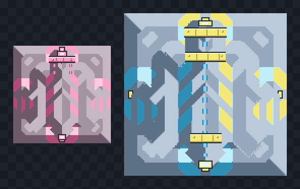

# Mass Driver Tiers

A small Mindustry mod that adds two late-game upgrades to the vanilla mass driver:
a **Thorium Mass Driver** and a **Surge Mass Driver**, plus Bayugo Crystals, the
B.B Collider factory, and the Manong Vault storage building.



## Blocks

| Block | Size | Health | Capacity | Range | Reload | Power | Research |
| --- | --- | --- | --- | --- | --- | --- | --- |
| Mass Driver (vanilla) | 3×3 | 380 | 120 | 440 (55 tiles) | 200 | 1.75 | — |
| **Thorium Mass Driver** | 3×3 | 760 | 180 | 640 (80 tiles) | 150 | 3 | Mass Driver |
| **Surge Mass Driver** | 5×5 | 1850 | 520 | 1200 (150 tiles) | 110 | 10 | Thorium Mass Driver |

Both blocks are in the **Distribution** category and behave exactly like the vanilla
mass driver: they link to a matching driver, buffer items, and launch payloads when
powered. Range is measured in world units (8 units per tile).

### Firing effects

The launch and receive effects are configured per block in JSON, so each tier has
its own signature:

- **Thorium** — pink shockwave ring, rose spark streaks, a soft pink muzzle flash,
  and a lingering pink smoke puff. Launched shells leave a pink trail and glowing
  pink light.
- **Surge** — a wide cyan shockwave plus a delayed surge-yellow ring, cyan and
  yellow spark streaks, and a cyan smoke puff. Shells leave a yellow trail with a
  cyan glow.

Both tiers also use a stronger screen shake than vanilla (4 and 10 vs. 3) so the
larger drivers feel heavier when they fire.

## Bayugo Crystal

A highly volatile grey colored crystal formed from using unnatural methods to synthesize in the B.B Collider. Used to build the Manong
Vault and as a late-game strategic material.

| Property | Value |
| --- | --- |
| Color | Grey (`8a8a8a`) |
| Crafted at | The B.B Collider (5×5) |
| Ingredients | 120 slag, 80 silicon, 50 thorium, 40 blast-compound, 100 cryofluid |
| Craft time | 900 ticks |

## The B.B Collider

A massive 5×5 particle collider that synthesizes materials that dont normally combine into rare  and highly volatile Bayugo Crystals. Late-game only,
high power draw, expensive to build.

| Property | Value |
| --- | --- |
| Size | 5×5 |
| Health | 2500 |
| Category | Production |
| Craft time | 900 ticks |
| Power | 20 |
| Research | Surge Mass Driver |

**Build cost:**

- 350 surge alloy
- 300 thorium
- 250 silicon
- 250 titanium
- 200 plastanium
- 120 phase fabric

**Craft recipe (per crystal):**

- 120 slag
- 100 cryofluid
- 80 silicon
- 50 thorium
- 40 blast-compound

## Manong Vault

- A colossal 7×7 storage vault engineered to interface directly with your core's
inventory. Place it anywhere and route belts straight into it - items flow to and
from core storage. Extremely expensive, late-game strategic building.
- Named after a prized engineer with consumer-storage expertise.

| Property | Value |
| --- | --- |
| Size | 7×7 |
| Health | 9000 |
| Item capacity | 20000 |
| Category | Storage |
| Research | The B.B Collider |

**Build cost:**

- 600 surge alloy
- 500 thorium
- 500 titanium
- 400 plastanium
- 250 phase fabric
- 250 bayugo crystals

### Core inventory note

- The Manong Vault is designed to link to your core's logistics network so you can
input/output items away from the crowded core area. True shared-core-inventory
behaviour requires custom game logic beyond pure JSON content; this release ships
the vault as a high-capacity storage block (20,000 items) that you can place
anywhere to decentralize your core's buffer.
- Manong Vault ensures that no matter how many rice you consume, as long as your rice fields are running, you. will always. strive.

### Costs

**Thorium Mass Driver**

- 185 thorium
- 150 titanium
- 125 silicon
- 200 lead
- 300 copper

**Surge Mass Driver**

- 60 phase fabric
- 200 surge alloy
- 250 thorium
- 250 silicon
- 300 titanium
- 300 graphite

## Installation
- Using the in-game mod browser or Skhallops/More-Utils

- Requires **Mindustry v8 (build 160 or newer)**. The mod is data-only (JSON), so it
works on desktop and mobile, in singleplayer and on servers (the server needs the
mod installed too).

- **Thorium** — mauve steel with rose plating and thorium-pink accents; a muzzle
  accelerator collar, dashed charge rails, a pink emitter core and a glowing rear
  prong tip.
- **Surge** — blue steel with cyan plating and surge-yellow accents; three
  accelerator collars, a cyan energy spine, a cyan/yellow emitter core and cyan
  edge ticks on the base. The 5×5 art is upscaled from the vanilla bitmap and
  re-quantized so it stays crisp pixel art.

Future blocks should follow the same pipeline: derive from the matching vanilla
asset, remap the palette, then add hand-placed tier detailing. This keeps every
addition visually consistent with the base game.

All sprites and the mod icon are generated with [Pillow](https://python-pillow.org/),
so they can be re-rendered after tweaking the palettes or geometry:

```sh
py -3 tools/generate_sprites.py
py -3 tools/generate_grey_sprites.py
```

This writes:

- `sprites/thorium-mass-driver.png` / `-base.png` (96×96, 3×3)
- `sprites/surge-mass-driver.png` / `-base.png` (160×160, 5×5)
- `sprites/bayugo-crystal.png` (32×32, item)
- `sprites/b-b-collider.png` / `-base.png` (160×160, 5×5)
- `sprites/manong-vault.png` / `-base.png` (224×224, 7×7)
- `icon.png` (128×128)
- `docs/preview.png` (README preview sheet)

Mindustry auto-prefixes mod sprite names with the mod's internal name
(`mass-driver-tiers`), so the file names map directly to the block names.
Each mass driver needs two regions: the rotating turret (`<name>.png`) and the
static base (`<name>-base.png`).

> **Asset credit / license:** the vanilla mass driver sprite is part of
> [Mindustry](https://github.com/Anuken/Mindustry) by Anuken and contributors, which
> is licensed under the **GPLv3**. The tier sprites here are derivative works of
> that asset and are distributed under the same license.

## Notes

- Balance is tuned as an endgame tier above the vanilla driver; edit the JSON files
  in `content/blocks/` to change stats or costs.
- `"name"` and `"description"` are set inline in each block JSON, so display names
  and descriptions are added to the bundle at load time without a separate
  `bundles/` file.

### Also Worth Mentioning
- Always do basic human hygiene like showering and brushing teeth before you engage in outdoor activities.
- It is advised that you wear socks because some individuals find it funny when you dont wear one, emotional precausions are worth keepibg in mind when in scenarios like these.
